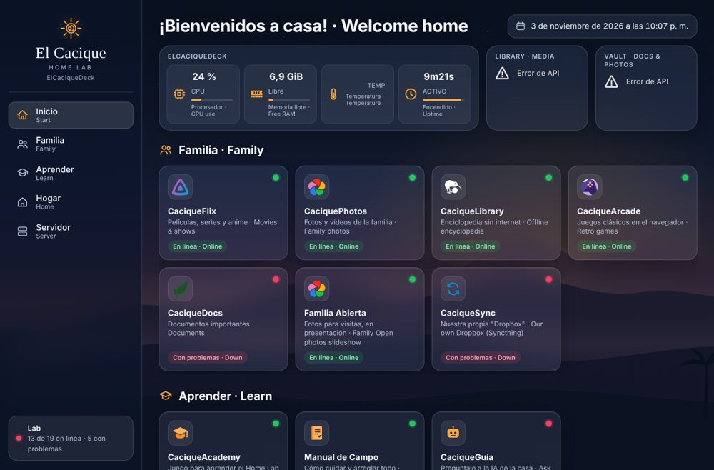
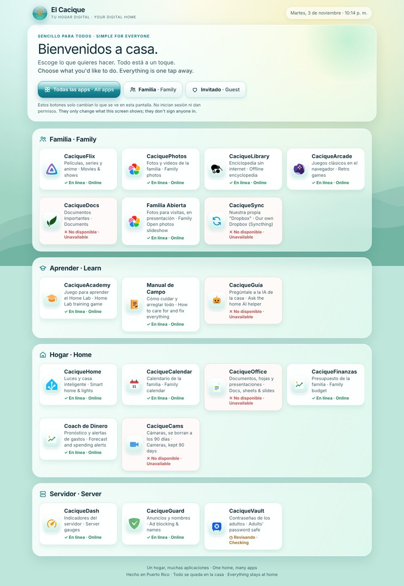
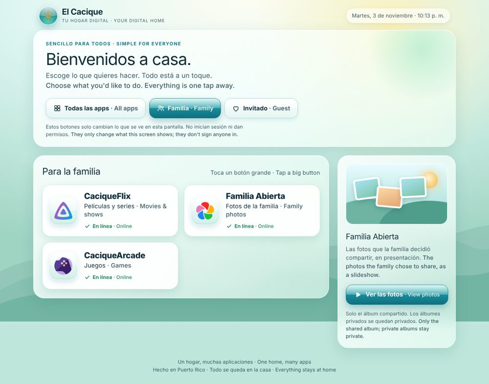
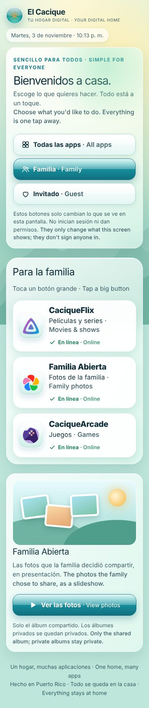
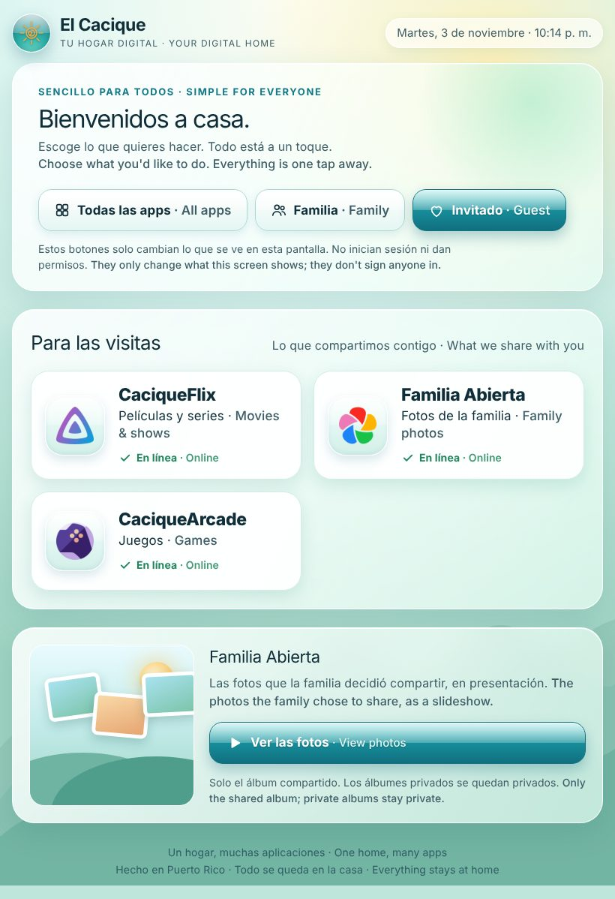
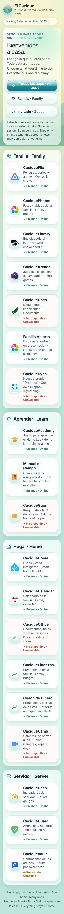

# 🌿 Cacique front page — "Aero Naturaleza" (Familia & Invitado)

> **Branch:** `homepage-aero` · **Status:** built and tested against a real Homepage (gethomepage v2.6) with test servers.
> *La página de la familia: sencilla, en español e inglés, sin números del servidor.*

**The idea:** the front page is a calm front door, not a control room. It has the friendly glass-and-sky feel of the
Windows Vista / XP years, when computers felt safe and simple to explore. All server numbers stay in **CaciqueDash** (port 8888).

| Before | After · Todas las apps | After · Familia |
|---|---|---|
|  |  |  |

| Familia on a phone | Invitado on a tablet | Todas on a small phone (320 px) |
|---|---|---|
|  |  |  |

## What changed
| File | Change | Why |
|---|---|---|
| `homepage/config/widgets.yaml` | Now an empty list | Removes CPU, memory, temperature, uptime and disk widgets from the front page. CaciqueDash still has all of them |
| `homepage/config/settings.yaml` | Light theme, default cards, 4/3/3/3 columns | Base for the light Aero look |
| `homepage/config/custom.css` | Rewritten: sky + Puerto Rican hills drawn in CSS, glass panels, glossy buttons, big cards, status words | The look; works offline (no web fonts, no outside images) |
| `homepage/config/custom.js` | Rewritten: header + date, the three views, big buttons, Familia Abierta panel, status words, accessible labels | The behavior; it only reads what Homepage draws |
| `docs/homepage-aero.md` + `docs/homepage-aero/*.jpg` | This page + screenshots | Review and rollback |

**Unchanged:**
- `services.yaml`: every link, every `siteMonitor` check and every `# needs` filter.
- `make-live-config.sh`, `setup-homepage.sh`, `docker-compose.yml` and `caciquedash.py`.
- Every app account, rating and password.

## The three views (buttons at the top)
| View | Shows | For |
|---|---|---|
| **Todas las apps · All apps** (default) | Every installed app in its group (Familia, Aprender, Hogar, Servidor), each with its status in words | Adults |
| **Familia** | Extra-large buttons: **CaciqueFlix, Familia Abierta, CaciqueArcade** + the Familia Abierta panel | Kids, grandparents |
| **Invitado · Guest** | The same three shared apps + the Familia Abierta panel | Visitors |

- **Each device remembers its own choice.** A living-room tablet can be set once to Familia.
- **A bookmark can open straight into a view:** `http://<laptop>/#familia` or `http://<laptop>/#invitado`.
- **Adding apps to the Familia view:** CaciqueLibrary and CaciqueAcademy can go there once their content has been checked for kids. Add their names to `VIEWS.familia.apps` at the top of `custom.js`.

**Status words** (an icon plus text, never color alone): **✓ En línea · Online**, **✕ No disponible · Unavailable**, **◷ Revisando · Checking**.
They come from Homepage's real health checks, not invented values.

## Security: what the views are and aren't
- The view buttons **only change what this screen shows.** They don't log anyone in, don't block anything, and say so on the page.
- The protection stays where it was, **inside each app:**
  - Jellyfin ratings: Familia **PG**, Invitado **PG-13**, unrated media hidden.
  - Immich private albums, Paperless documents, Vaultwarden and Frigate: each behind its own account.
  - RomM: guest kiosk mode.
- Anyone on the home Wi-Fi can still switch to "Todas las apps". The app logins are the real barrier, same as before.
- **The Familia Abierta panel** is a button to the **already-shared** slideshow link only:
  - No thumbnails, no private albums, no photos in GitHub.
  - It hides itself when that shared link isn't set up.
  - The illustration is drawn in CSS; it isn't a real photo.

## Test results
| # | Test | Result |
|---|---|---|
| T01 | No CPU/RAM/temperature/uptime/disk/% on the front page, in all 3 views | ✅ none found (automated text scan) |
| T02 | Links, health checks and `# needs` filtering kept | ✅ links unchanged; live copy filters by installed apps |
| T03 | Status in words for all 3 states | ✅ 13 Online, 5 Unavailable, 1 Checking (test servers) |
| T04/T05 | Familia / Invitado show only Flix, Familia Abierta, Arcade; the directory is hidden | ✅ |
| T06 | No private apps, previews or thumbnails in Familia/Invitado | ✅ |
| T07 | Views labelled as presentation only | ✅ note on the page + in code |
| T08 | CaciqueDash still reachable for adults (a link only, no numbers) | ✅ card in Servidor |
| T09 | Slideshow panel: only the shared link, hides cleanly, works offline | ✅ (a link-out panel, no autoplay) |
| T10 | 320 px, 390 px, tablet, desktop: no sideways scrolling; keyboard order and visible focus ring | ✅ all 12 screens; Tab: views → big buttons → photos button |
| — | Touch targets ≥ 56 px; reduced-motion turns animations off | ✅ 56–145 px; 0 s transitions |
| T11 | No secrets, names, passwords, private photos or IPs committed | ✅ screenshots use test data on 127.0.0.1 |
| T12 | `make-live-config.sh` copies the new files | ✅ verified byte-for-byte |

## Put it on the IdeaPad (when you're happy with the screenshots)
1. `cd ~/elcaciquedeck && git fetch && git checkout homepage-aero`
2. `bash ~/elcaciquedeck/homepage/make-live-config.sh`
3. `cd ~/elcaciquedeck/homepage && docker compose restart`
4. On a phone or computer: open `http://<laptop>` and **refresh** (or use a private tab, since browsers keep the old look for a while).

## Undo (back to the previous dark design)
1. `cd ~/elcaciquedeck && git checkout main`
2. `bash ~/elcaciquedeck/homepage/make-live-config.sh`
3. `cd ~/elcaciquedeck/homepage && docker compose restart`
